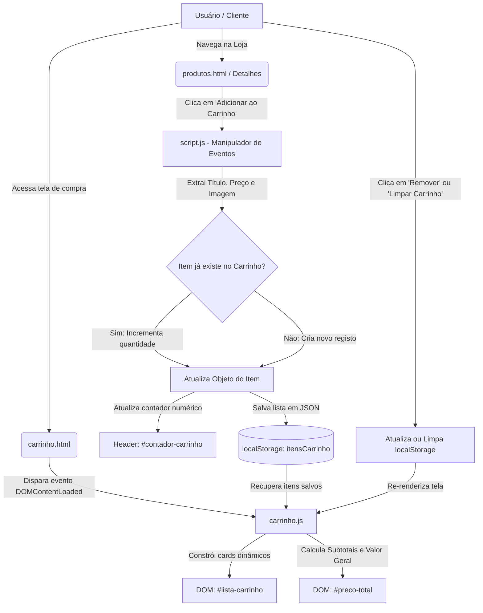
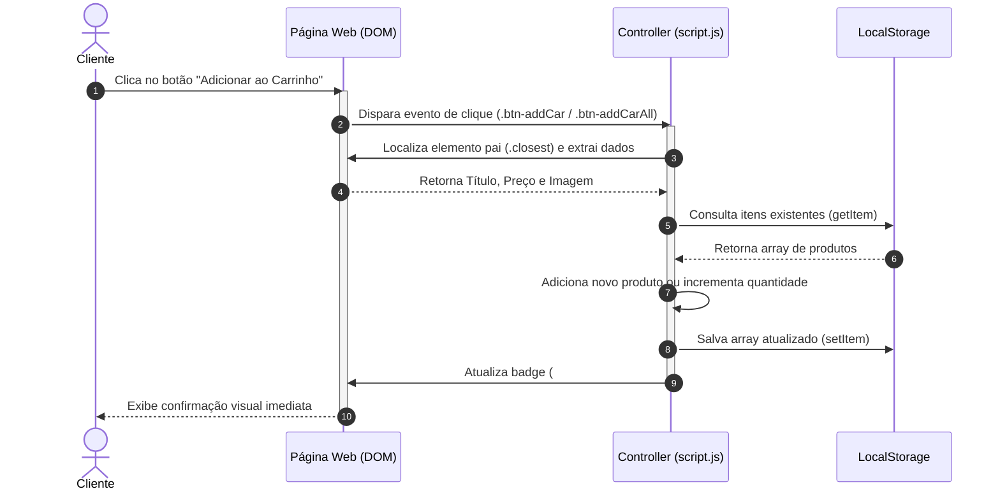

# 🛍️ MyCare - E-Commerce & Site Institucional


Bem-vindo ao repositório do **MyCare**! Este projeto é um website institucional e e-commerce estático desenvolvido para a apresentação e simulação de vendas de produtos de autocuidado, cosméticos naturais e *skincare* (serum facial, esfoliante corporal, creme noturno, bruma revitalizante, máscara de argila e bálsamo labial).

> 🎓 **Projeto Acadêmico & Finalidade de Estudo:**  
> Desenvolvido no curso de **Análise e Desenvolvimento de Sistemas (ADS)** do **Centro Universitário Claretiano**, para a disciplina de **Programação WEB**, sob orientação do **Prof. Jonatas Ferreira**.
>  
> 📌 **Histórico de Desenvolvimento:**  
> - **Parte 1 (Concluída):** Estruturação inicial do site utilizando apenas **HTML5** semântico.  
> - **Parte 2 (Concluída):** Estilização completa com **CSS3**, *CSS Grid*, *Flexbox*, responsividade e páginas individuais de detalhes dos produtos.  
> - **Parte 3 (Atual):** Dinamismo e interatividade com **JavaScript (ES6)** (gerenciamento de carrinho de compras, contadores em tempo real e persistência com `localStorage`), documentação técnica em Markdown e modelagem de arquitetura com diagramas **Mermaid.js (SAD)**.

---

## 📌 Sumário

- [📖 Visão Geral](#-visão-geral)
- [📁 Estrutura do Projeto](#-estrutura-do-projeto)
- [📄 Documentação das Páginas](#-documentação-das-páginas)
  - [1. Página Inicial (index.html)](#1-página-inicial-indexhtml)
  - [2. Catálogo de Produtos (produtos.html)](#2-catálogo-de-produtos-produtoshtml)
  - [3. Detalhes dos Produtos (produtos/produto1.html a produto6.html)](#3-detalhes-dos-produtos-produtosproduto1html-a-produto6html)
  - [4. Carrinho de Compras (carrinho.html)](#4-carrinho-de-compras-carrinhohtml)
  - [5. Contato e Atendimento (contato.html)](#5-contato-e-atendimento-contatohtml)
- [⚙️ Recursos de Interatividade (JavaScript)](#️-recursos-de-interatividade-javascript)
- [📚 Documentação Teórica (Markdown, SAD e Mermaid.js)](#-documentação-teórica-markdown-sad-e-mermaidjs)
- [🌐 Ferramentas de Diagramação Mermaid.js](#-ferramentas-de-diagramação-mermaidjs)
- [📊 Modelagem de Arquitetura de Software (SAD com Mermaid.js)](#-modelagem-de-arquitetura-de-software-sad-com-mermaidjs)
- [🧩 Matriz de Componentes e Responsabilidades (SAD)](#-matriz-de-componentes-e-responsabilidades-sad)
- [🛠️ Tecnologias e Recursos Utilizados](#️-tecnologias-e-recursos-utilizados)
- [🚀 Como Executar o Projeto](#-como-executar-o-projeto)
- [📷 Créditos de Mídia](#-créditos-de-mídia)
- [📝 Licença](#-licença)

---

## 📖 Visão Geral

O **MyCare** foi projetado para entregar uma experiência de compras e navegação moderna, intuitiva e acolhedora no segmento de cosméticos naturais. 

Com a conclusão da **Parte 3**, o ecossistema conta com:
- **Navegação Consistente:** Cabeçalho com menu responsivo e ícone de carrinho com contador numérico dinâmico (badge) visível em todas as telas.
- **Catálogo e Páginas de Detalhes:** Layout modular com grid responsivo, fotos em alta resolução, descrições detalhadas, listas de benefícios e botões interativos de compra.
- **Carrinho Completo:** Adição dinâmica tanto pela vitrine quanto pela página de detalhes, com atualização de quantidades, cálculo de subtotais e valor total, além de remoção individual e opção de esvaziamento.

---

## 📁 Estrutura do Projeto

```text
loja_produtos/
├── css/
│   └── style.css            # Estilos globais, variáveis, Flexbox/Grid e responsividade
├── js/
│   ├── script.js            # Lógica global: captura de cliques, badge e gravação no localStorage
│   └── carrinho.js          # Lógica da tela de carrinho: renderização, cálculo de totais e exclusão
├── imagens/
│   ├── banners/             # Logo institucional e banners de divulgação
│   └── produtos/            # Fotografias organizadas por produto
│       ├── serum/
│       ├── esfoliante/
│       ├── creme/
│       ├── bruma/
│       ├── mascara/
│       └── balsamo/
├── produtos/                # Páginas de detalhes individuais dos produtos
│   ├── produto1.html        # Serum Facial Iluminador
│   ├── produto2.html        # Esfoliante Corporal Renovador
│   ├── produto3.html        # Creme Noturno Nutritivo
│   ├── produto4.html        # Bruma Facial Revitalizante
│   ├── produto5.html        # Máscara Facial Argila Branca
│   └── produto6.html        # Bálsamo Labial Reparador
├── index.html               # Página inicial institucional
├── produtos.html            # Catálogo geral de produtos
├── carrinho.html            # Tela de visualização e gerenciamento do carrinho
├── contato.html             # Formulário de atendimento e suporte
└── README.md                # Documentação técnica e arquitetura de software
```

---

## 📄 Documentação das Páginas

### 1. Página Inicial (`index.html`)
- Apresentação visual da marca, propostas de sustentabilidade e destaques institucionais.
- Barra de navegação com links rápidos e badge de carrinho sincronizado.

### 2. Catálogo de Produtos (`produtos.html`)
- Grade flexível e responsiva estruturada via CSS Grid.
- Cartões com imagem, título, preço fixado e botões para visualizar detalhes ou adicionar direto ao carrinho.

### 3. Detalhes dos Produtos (`produtos/produto1.html` a `produto6.html`)
- Layout em card com imagem em alta resolução (`max-width: 450px`).
- Título principal (`<h1>`), preço de referência, descrição semântica, lista de benefícios e botão interativo de compra.

### 4. Carrinho de Compras (`carrinho.html`)
- Renderização dinâmica orientada a dados a partir do `localStorage`.
- Lista os itens adicionados com imagem, preço unitário, quantidade e subtotal.
- Permite remover itens individuais ou limpar todo o carrinho com confirmação.
- Exibe o resumo de quantidades e valor total formatado em moeda brasileira (BRL).

### 5. Contato e Atendimento (`contato.html`)
- Formulário com campos de Nome, E-mail e Mensagem para simulação de suporte ao cliente.

---

## ⚙️ Recursos de Interatividade (JavaScript)

O projeto cumpre os requisitos de interatividade da **Opção C (Vitrine Interativa e Carrinho de Compras)**:
- **Captura e Extração do DOM:** O `script.js` escuta cliques nos botões de adição (`.btn-addCarAll`, `.btn-addCar`), descobre o container pai através de `.closest()` e extrai nome, imagem e preço numérico do elemento.
- **Persistência com LocalStorage:** Os dados da compra são salvos sob a chave `itensCarrinho` em formato JSON, persistindo mesmo se o usuário fechar ou recarregar a página.
- **Badge Dinâmico:** O contador numérico no ícone de carrinho do cabeçalho é recalculado e atualizado em tempo real somando a quantidade total de itens.
- **Feedback Visual:** Ao adicionar um item, o botão exibe temporariamente a mensagem *"Adicionado! ✓"* e desabilita o clique brevemente para evitar duplicações acidentais.
- **Renderização e Manipulação do DOM:** O `carrinho.js` injeta dinamicamente o HTML dos produtos, calcula subtotais, soma o valor total com formatação monetária (`Intl.NumberFormat` / `toLocaleString`) e permite excluir itens com atualização imediata da tela.

---

## 📚 Documentação Teórica (Markdown, SAD e Mermaid.js)

### 1. O que é Markdown e Quem o Criou?
- **Definição:** Markdown é uma linguagem de marcação leve que possibilita formatar documentos em texto puro utilizando caracteres e símbolos simples e legíveis (como `#`, `*`, `_`, `` ` ``). O texto escrito em Markdown é facilmente lido por humanos sem renderização e pode ser convertido de forma rápida e precisa para HTML válido.
- **Histórico e Criadores:** Foi criada em **2004** por **John Gruber** com a colaboração ativa de **Aaron Swartz**. O objetivo principal era permitir que autores escrevessem para a web de forma limpa, rápida e estruturada sem a necessidade de redigir tags HTML manualmente.

### 2. O que é SAD (Software Architecture Document)?
- **Definição:** O **SAD** (*Software Architecture Document*, ou Documento de Arquitetura de Software) é um artefato formal da Engenharia de Software voltado a registrar e comunicar a arquitetura global de um sistema.
- **Finalidade:** O documento descreve a divisão em camadas, padrões de projeto adotados, diagramas conceituais, fluxos de dados, componentes e decisões técnicas tomadas pela equipe de desenvolvimento, servindo como guia mestre para implantação, auditoria e manutenção da aplicação.

### 3. O que é Mermaid.js?
- **Definição:** Mermaid.js é uma biblioteca baseada em JavaScript que interpreta declarações de texto simples inspiradas no Markdown e as compila dinamicamente em diagramas, fluxogramas, cronogramas e gráficos complexos renderizados nativamente em SVG no navegador ou em editores modernos.

---

## 🌐 Ferramentas de Diagramação Mermaid.js

Para planejar, codificar e testar diagramas Mermaid antes da publicação no repositório, utilizam-se os seguintes recursos:
1. **[Mermaid Live Editor (Oficial)](https://mermaid.live):** Ambiente web oficial que permite digitação do código, visualização em tempo real, geração de links e exportação para formatos PNG e SVG.
2. **[Mermditor](https://www.mermditor.dev/editor):** Editor focado em agilidade e interface limpa para validação instantânea de diagramas.
3. **[Mermaid Chart](https://www.mermaidchart.com):** Plataforma avançada e colaborativa com templates e integração direta a ambientes de desenvolvimento.
4. **Extensões para o Visual Studio Code (VS Code):**
   - *Markdown Preview Mermaid Support:* Habilita a compilação de diagramas Mermaid na pré-visualização padrão do Markdown.
   - *Mermaid Preview:* Painel dedicado para testar e inspecionar os diagramas lado a lado com o código.
5. **Renderização Nativa no GitHub:** O próprio GitHub interpreta e renderiza automaticamente blocos de código com a identificação `mermaid` no arquivo `README.md`.

---

## 📊 Modelagem de Arquitetura de Software (SAD com Mermaid.js)

### Fluxograma do Ciclo de Vida do Carrinho de Compras
O diagrama abaixo demonstra o fluxo de interação do cliente, manipulação do DOM e ciclo de persistência no navegador:



### Diagrama de Sequência: Adição de Produto
Representação temporal da troca de mensagens entre o usuário, os elementos visuais e a camada de persistência:



---

## 🧩 Matriz de Componentes e Responsabilidades (SAD)

### a) Especificação de Componentes do Sistema

| Componente / Arquivo | Camada (SAD) | Tecnologia | Responsabilidade Principal |
| :--- | :--- | :--- | :--- |
| `index.html` | Apresentação (View) | HTML5 | Página inicial institucional, proposta da marca e atalhos de navegação. |
| `produtos.html` | Apresentação (View) | HTML5 | Vitrine de cosméticos em formato grid com opções de compra direta. |
| `produtos/produto*.html` | Apresentação (View) | HTML5 | Telas individuais com especificações, benefícios e foto ampliada do produto. |
| `carrinho.html` | Apresentação (View) | HTML5 | Estrutura de visualização, listagem dos itens e fechamento da compra. |
| `contato.html` | Apresentação (View) | HTML5 | Formulário de atendimento e suporte ao cliente. |
| `css/style.css` | Estilização (Style) | CSS3 | Layout Flexbox/Grid, responsividade, variáveis de cor, tipografia e resets. |
| `js/script.js` | Lógica / Controller | JavaScript (ES6) | Captura de cliques na vitrine/detalhes, extração de dados e atualização do badge. |
| `js/carrinho.js` | Lógica / Controller | JavaScript (ES6) | Geração dos cards no DOM, cálculo de totais, remoção e esvaziamento do carrinho. |
| `README.md` | Documentação | Markdown & Mermaid | Apresentação da arquitetura SAD, conceitos teóricos e guia de execução. |

### b) Matriz de Responsabilidade por Funcionalidade

| Requisito / Funcionalidade | HTML (`*.html`) | CSS (`style.css`) | JavaScript (`*.js`) | Documentação (`README.md`) |
| :--- | :---: | :---: | :---: | :---: |
| **Estrutura Semântica e Acessibilidade** | **Principal** | Suporte | — | — |
| **Design Responsivo e Estilização** | Suporte | **Principal** | Suporte (Classes dinâmicas) | — |
| **Fluxo e Gestão do Carrinho** | Suporte (Containers) | Suporte (Estilos de cards) | **Principal** (Lógica / Cálculos) | — |
| **Persistência de Dados no Cliente** | — | — | **Principal** (`localStorage`) | — |
| **Documentação da Arquitetura (SAD)** | — | — | — | **Principal** (Diagramas e Matrizes) |

---

## 🛠️ Tecnologias e Recursos Utilizados

- **HTML5:** Marcação semântica e acessível (`<header>`, `<nav>`, `<main>`, `<section>`, `<footer>`).
- **CSS3:** Estilização com *Flexbox*, *CSS Grid*, Media Queries para responsividade e animações suaves.
- **JavaScript (ES6):** Manipulação de eventos do DOM, arrays (`find`, `reduce`, `splice`), JSON e API `localStorage`.
- **Bootstrap (v5.3.8) & Bootstrap Icons (v1.13.1):** Grid complementar e ícones vetoriais integrados via CDN.
- **VS Code:** Editor de código com extensões de pré-visualização e Live Server.

---

## 🚀 Como Executar o Projeto

1. **Clonar o repositório:**
   ```bash
   git clone [https://github.com/VitorAssalin/mycare-css-stylesheet.git](https://github.com/VitorAssalin/mycare-css-stylesheet.git)
   ```

2. **Acessar a pasta do projeto:**
   ```bash
   cd mycare-css-stylesheet
   ```

3. **Executar no Navegador:**
   - Abra o arquivo `index.html` diretamente em seu navegador (Chrome, Edge, Firefox ou Safari).
   - *Recomendação:* No VS Code, utilize a extensão **Live Server** para execução com recarregamento em tempo real.

4. **Demonstração Online (GitHub Pages):**
   - [Acessar MyCare no GitHub Pages](https://vitorassalin.github.io/mycare-css-stylesheet/)

---

## 📷 Créditos de Mídia

- **Imagens dos Produtos e Banners:** Produzidas exclusivamente para fins educacionais de simulação de catálogo de cosméticos.
- **Ícones da Interface:** Bootstrap Icons.

---

## 📝 Licença

Projeto desenvolvido para fins estritamente acadêmicos e educacionais. Livre para consulta, estudos e melhorias.

Desenvolvido por **Vitor Assalin** — MyCare © 2026